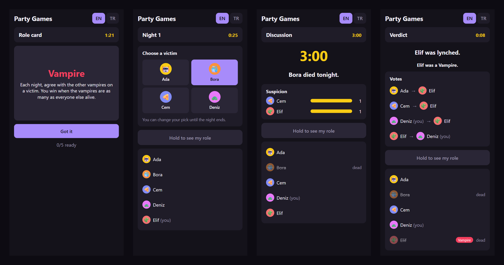

# ESP32 Party Games

**English** · [Türkçe](README.tr.md)

**Jackbox-style party games with no app and no internet, on a $5 ESP32.**

[](https://emirfs.github.io/esp32-party-games/)
[](https://github.com/Emirfs/esp32-party-games/actions/workflows/ci.yml)
[](LICENSE)



The board opens its own Wi-Fi; everyone at the table joins it and plays in the
phone browser. First game: **Vampires & Villagers** (Werewolf/Mafia-style) for
5–15 players. Roles, night moves and votes live on the box, so nobody can peek
and nobody needs to be the narrator. The UI speaks English and Turkish.

## Quick start (2 minutes)

1. **Flash.** Plug an ESP32-S3 board (≥ 8 MB flash) into a computer, open the
   [browser flasher](https://emirfs.github.io/esp32-party-games/) in Chrome or
   Edge and click **Install**. Prefer the command line? Grab the `.bin` from
   [Releases](https://github.com/Emirfs/esp32-party-games/releases/latest) and run
   `esptool.py --chip esp32s3 write_flash 0x0 esp32-party-games-<version>.bin`.
2. **Join the Wi-Fi.** Power the board from a phone (USB-C OTG) or a power bank.
   On every phone join `PartyGames-XXXX` with password `partygames`; the sign-in
   page opens by itself, or open `http://192.168.4.1`.
3. **Become admin.** Everyone picks a name, avatar and colour. The first phone to
   tap **Become admin** runs the game; it also shows a Wi-Fi QR code for late
   arrivals. Admin phone lost? Hold the board's BOOT button for 5 seconds.
4. **Play.** Players tap **I'm in**; the admin picks **Vampires & Villagers**,
   sets the options and taps **Start**.

## How to play Vampires & Villagers

- **Roles:** vampires (1–3 depending on the player count), a doctor, a seer and
  villagers. Hold your role card to peek at it.
- **Night:** everyone plays at once and every screen has a task (vampires pick a
  victim, the doctor protects, the seer inspects, villagers mark a suspect), so
  tapping your phone gives nothing away. Vampires see each other's picks live.
- **Dawn:** the box tells who died, if anyone.
- **Discussion and vote:** argue, then everyone votes in secret; the votes are
  revealed together and the top suspect is lynched. A tie gets one runoff.
- **Win:** the village wins when every vampire is dead; the vampires win when
  they are at least as many as everyone else.
- Dead players become ghosts and (by default) see every role.

Full rules: [docs/design.md §8](docs/design.md#8-vampires--villagers-rules).

## Hardware: bare or box

| | **Bare** | **Box** |
|---|---|---|
| Hardware | Any ESP32-S3 board (≥ 8 MB flash), USB-C cable to a phone | Bare + any of: speaker, LED ring, OLED, button, LiPo battery, NFC sticker |
| Game host | The admin phone (usually the one powering the board) runs the game: start, timers, settings | Same, plus the box shows phase/timer/QR and plays narration itself |
| Firmware | Same binary | Same binary; each add-on is switched on in the admin settings |

Every add-on is optional and has a phone fallback; the game never requires one.
Reference board: ESP32-S3 N16R8 (DevKitC-1).

## Build from source

Requirements: [PlatformIO Core](https://platformio.org/install/cli) running on
Python 3.13 or older (its ESP-IDF builder cannot install its Python packages on
3.14 yet), Node.js 20+.

```sh
cd firmware
pio run -t upload      # builds web/ first, embeds it, flashes the board
pio device monitor
pio test -e native     # game logic unit tests and the bot simulator on your PC
```

## UI development without a board

The host simulator runs the same `core/` and `games/` code as the box on your PC:

```sh
cd firmware && pio run -e host
cd ../web && npm run sim                       # terminal 1: simulator + WebSocket bridge
PG_BOX=http://localhost:7420 npm run dev       # terminal 2, in web/: UI with hot reload
```

(PowerShell: `$env:PG_BOX="http://localhost:7420"; npm run dev`.) Every player
needs its own tab with its own `?dev=` name, e.g. `http://localhost:5173/?dev=ada`,
`?dev=bob`, … (without it all tabs share one player id). Against a real
board instead: join its Wi-Fi from your PC and run `npm run dev` in `web/`.

## Documentation

- [docs/protocol.md](docs/protocol.md) — WebSocket protocol and view schema
- [docs/add-a-game.md](docs/add-a-game.md) — add your own game
- [CONTRIBUTING.md](CONTRIBUTING.md) — setup, rules, tests, pull requests
- [docs/roadmap.md](docs/roadmap.md) — phases, tasks and status
- [docs/design.md](docs/design.md) — design, add-on plan and game rules

## Languages

The UI opens in Turkish when the phone's language is Turkish and in English
otherwise; the EN/TR buttons switch it. Strings live in `web/src/i18n.ts`.
Docs are written in English with Turkish translations next to them (`*.tr.md`).

## License

MIT — see [LICENSE](LICENSE).
