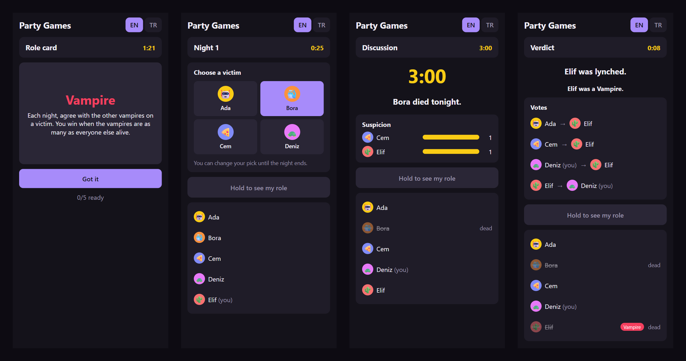

# ESP32 Party Games

[English](README.md) · **Türkçe**

> Esas metin İngilizce [README.md](README.md)'dir; bu sayfa onun çevirisidir.

**5 dolarlık bir ESP32'de, uygulamasız ve internetsiz Jackbox tarzı parti oyunları.**

[](https://emirfs.github.io/esp32-party-games/)
[](https://github.com/Emirfs/esp32-party-games/actions/workflows/ci.yml)
[](LICENSE)



Kart kendi Wi-Fi ağını açar; masadaki herkes bağlanıp telefon tarayıcısından
oynar. İlk oyun: 5–15 kişilik **Vampir Köylü** (Werewolf/Mafya tarzı). Roller,
gece hamleleri ve oylar kutuda tutulur; kimse başkasının kartını göremez, kimsenin
anlatıcı olması gerekmez. Arayüz İngilizce ve Türkçe.

## Hızlı başlangıç (2 dakika)

1. **Yükle.** ESP32-S3 kartı (≥ 8 MB flash) bilgisayara takın,
   [tarayıcıdan yükleme sayfasını](https://emirfs.github.io/esp32-party-games/)
   Chrome veya Edge ile açın ve **Yükle**'ye tıklayın. Komut satırı mı
   istersiniz? [Releases](https://github.com/Emirfs/esp32-party-games/releases/latest)
   sayfasından `.bin` dosyasını indirip
   `esptool.py --chip esp32s3 write_flash 0x0 esp32-party-games-<sürüm>.bin` çalıştırın.
2. **Wi-Fi'ye bağlan.** Karta bir telefondan (USB-C OTG) ya da powerbankten güç
   verin. Her telefonda `PartyGames-XXXX` ağına `partygames` şifresiyle bağlanın;
   giriş sayfası kendiliğinden açılır, açılmazsa `http://192.168.4.1` adresine gidin.
3. **Yönetici ol.** Herkes ad, avatar ve renk seçer. **Yönetici ol**'a ilk dokunan
   telefon oyunu yönetir; geç gelenler için Wi-Fi QR kodunu da o gösterir.
   Yönetici telefon kayıp mı? Kartın BOOT düğmesini 5 saniye basılı tutun.
4. **Oyna.** Oyuncular **Varım**'a dokunur; yönetici **Vampir Köylü**'yü seçer,
   ayarları yapar ve **Başlat**'a dokunur.

## Vampir Köylü nasıl oynanır

- **Roller:** vampirler (oyuncu sayısına göre 1–3), bir doktor, bir gözcü ve
  köylüler. Rolünüzü görmek için kartı basılı tutun.
- **Gece:** herkes aynı anda oynar ve herkesin ekranında bir görev vardır
  (vampirler kurban seçer, doktor korur, gözcü sorgular, köylüler şüphelisini
  işaretler); yani telefona dokunmak kimseyi ele vermez. Vampirler birbirinin
  seçimini canlı görür.
- **Şafak:** kutu kimin öldüğünü (ya da kimsenin ölmediğini) söyler.
- **Tartışma ve oylama:** tartışın, sonra herkes gizlice oy verir; oylar birlikte
  açılır ve en çok oy alan linç edilir. Eşitlikte bir tur daha oylanır.
- **Kazanma:** tüm vampirler ölünce köy kazanır; vampirler diğerleri kadar ya da
  daha çok olunca vampirler kazanır.
- Ölen oyuncular ruh olur ve (varsayılan olarak) tüm rolleri görür.

Kuralların tamamı: [docs/design.tr.md §8](docs/design.tr.md#8-vampir-köylü-kuralları).

## Donanım: yalın ya da kutu

| | **Yalın** | **Kutu** |
|---|---|---|
| Donanım | Herhangi bir ESP32-S3 kart (≥ 8 MB flash), telefona USB-C kablo | Yalın + istenen eklentiler: hoparlör, LED halka, OLED, buton, LiPo pil, NFC çıkartma |
| Oyunu yöneten | Yönetici telefon (genelde kartı besleyen telefon): başlatma, süreler, ayarlar | Aynı; ek olarak kutu aşamayı/süreyi/QR'ı gösterir, anlatımı kendisi çalar |
| Firmware | Aynı dosya | Aynı dosya; her eklenti yönetici ayarlarından açılır |

Her eklenti isteğe bağlıdır ve telefonda karşılığı vardır; oyun hiçbirine muhtaç
değildir. Referans kart: ESP32-S3 N16R8 (DevKitC-1).

## Kaynaktan derleme

Gerekenler: Python 3.13 veya daha eski bir sürümle çalışan
[PlatformIO Core](https://platformio.org/install/cli) (ESP-IDF derleyicisi Python
paketlerini 3.14'te henüz kuramıyor), Node.js 20+.

```sh
cd firmware
pio run -t upload      # önce web/ derlenir, gömülür, karta yüklenir
pio device monitor
pio test -e native     # oyun mantığının birim testleri ve bot simülatörü, bilgisayarda
```

## Kart olmadan arayüz geliştirme

Host simülatörü kutudaki `core/` ve `games/` kodunun aynısını bilgisayarda çalıştırır:

```sh
cd firmware && pio run -e host
cd ../web && npm run sim                       # 1. terminal: simülatör + WebSocket köprüsü
PG_BOX=http://localhost:7420 npm run dev       # 2. terminal, web/ içinde: anında yenilenen arayüz
```

(PowerShell: `$env:PG_BOX="http://localhost:7420"; npm run dev`.) Her oyuncu
kendi `?dev=` adıyla ayrı bir sekme ister, ör. `http://localhost:5173/?dev=ada`,
`?dev=bob`, … (bu olmadan bütün sekmeler aynı oyuncu kimliğini paylaşır).
Gerçek karta karşı çalışmak için: bilgisayarı kartın ağına bağlayıp `web/`
içinde `npm run dev` çalıştırın.

## Belgeler

- [docs/protocol.tr.md](docs/protocol.tr.md) — WebSocket protokolü ve görünüm şeması
- [docs/add-a-game.tr.md](docs/add-a-game.tr.md) — kendi oyununuzu ekleyin
- [CONTRIBUTING.tr.md](CONTRIBUTING.tr.md) — kurulum, kurallar, testler, pull request'ler
- [docs/roadmap.tr.md](docs/roadmap.tr.md) — fazlar, görevler ve durum
- [docs/design.tr.md](docs/design.tr.md) — tasarım, eklenti planı ve oyun kuralları

## Diller

Arayüz telefonun dili Türkçeyse Türkçe, değilse İngilizce açılır; EN/TR
düğmeleri değiştirir. Metinler `web/src/i18n.ts` içinde. Belgeler İngilizce
yazılır, Türkçe çevirileri yanlarında durur (`*.tr.md`).

## Lisans

MIT — bkz. [LICENSE](LICENSE).
